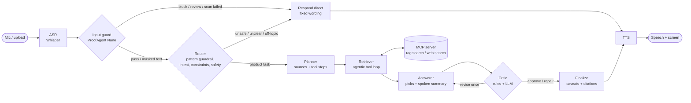

# ShopVoice: agentic voice-to-voice assistant for product discovery

A voice-to-voice, multi-agent shopping assistant. You ask a question out loud; it transcribes it, plans,
retrieves grounded evidence from a private catalog of 25,000 household supplies (Amazon Reviews 2023) through an MCP server,
optionally compares with live web results, checks its own answer, and speaks a short recommendation while the screen
shows the comparison table, citations and the full agent trace.

```
Voice -> ASR -> Input guard (ProofAgent Nano) -> Router -> Planner -> Retriever (MCP: rag.search / web.search) -> Answerer <-> Critic -> TTS
                                                                  evaluated end to end with ProofAgent
```

**Start with [index.html](index.html)**: an illustrated, single-file guide (works offline, light and dark themes) with the
interactive architecture diagram, the Router's routes, three recorded runs you can step through, and the evaluation
results. `python scripts/refresh_showcase.py` re-records the runs shown in it.

| Requirement | Where |
|---|---|
| LangGraph multi-agent workflow | `src/voice_agent/graph/` |
| ASR (Whisper) / TTS | `src/voice_agent/speech/` |
| Agentic RAG, hybrid retrieval | `src/voice_agent/rag/store.py`, `graph/nodes.py` (retriever) |
| MCP server with two tools | `src/voice_agent/mcp_server/`, [docs/MCP.md](docs/MCP.md) |
| UI (Streamlit) | `src/voice_agent/ui/app.py` |
| ProofAgent evaluation | `eval/`, [eval/README.md](eval/README.md), [eval/FAILURE_ANALYSIS.md](eval/FAILURE_ANALYSIS.md) |
| ProofAgent Nano runtime input guardrail (optional, `PROOFAGENT_GUARD=on`) | `src/voice_agent/input_guard.py`, [docs/INPUT_GUARD.md](docs/INPUT_GUARD.md) |
| Prompt disclosure | [prompts/](prompts/README.md) |
| Model-agnostic config | `.env.example`, `src/voice_agent/config.py`, `llm.py` |

## Quick start

Requires Python 3.10+ and [uv](https://docs.astral.sh/uv/) (or plain `pip`). No system ffmpeg is needed. Tested on Windows and on macOS (Apple Silicon, Python 3.12).

```bash
# 1. environment (Windows: scripts\setup.ps1)
./scripts/setup.sh                 # venv + pip install -e ".[eval,dev]" + creates .env
source .venv/bin/activate          # Windows: .venv\Scripts\Activate.ps1

# 2. configure: edit .env (LLM provider/model + key; optional web search key)

# 3. data + index (streams the public Hugging Face metadata, then about 8 minutes of CPU embedding)
./scripts/build_index.sh           # = download_hh2023 (once) + data.ingest + rag.store --build

# 4. run
./scripts/run_ui.sh                # Streamlit UI at http://localhost:8501
python -m voice_agent.pipeline "Recommend an eco-friendly stainless steel cleaner under fifteen dollars"
python -m voice_agent.pipeline --audio question.wav --speak
python scripts/mcp_smoke.py        # MCP discovery + one call per tool

# 5. evaluate
python -m pytest                   # 76 tests, no LLM needed (+10 opt-in live ProofAgent Nano tests)
python eval/run_retrieval_eval.py  # retrieval benchmark + ablation, no LLM (about 30 s)
python eval/run_stage_checks.py    # stage-level checks (add --voice for TTS -> ASR -> agent -> TTS)
python eval/run_proofagent.py      # ProofAgent scorecard -> eval/results/
```

> **Windows path limit.** If the project sits in a deep folder, create the virtual environment at a short path
> (`scripts\setup.ps1 -Venv C:\venvs\shopvoice`), otherwise package installs fail at 260 characters.

### Choosing the model (model-agnostic)

Nothing in the code names a provider. Two variables select any LangChain chat model:

| `.env` | Effect |
|---|---|
| `LLM_PROVIDER=openai` `LLM_MODEL=gpt-4.1-mini` | OpenAI (`OPENAI_API_KEY`) |
| `LLM_PROVIDER=anthropic` `LLM_MODEL=claude-haiku-5-5` | Anthropic (`ANTHROPIC_API_KEY`); `claude-sonnet-5-5` for more capability |
| `LLM_PROVIDER=ollama` `LLM_MODEL=qwen3:14b` | local open-weight model, no key |
| `LLM_PROVIDER=google_genai` / `bedrock_converse` | install the matching `langchain-*` package |
| `LLM_PROVIDER=rules` | no model: every node uses its deterministic fallback (tests, offline demo) |

Structured outputs use function calling and the Retriever binds the MCP tools with `bind_tools`, so tool calling
stays enabled on every provider. One provider difference is handled in `llm.py`, not in the nodes: current Claude
models reject a forced `tool_choice`, so for Claude the schema is offered as a tool with `tool_choice=auto` and the
prompt asks for the call (`LLM_STRUCTURED_MODE=auto`); other providers force the schema tool (`forced`). No sampling
temperature is sent unless `LLM_TEMPERATURE` is set. A hosted provider with no API key is reported in the UI and
the pipeline runs on its rule-based fallbacks rather than failing. Every call has an output cap and a timeout
(`LLM_MAX_TOKENS`, `LLM_TIMEOUT_SECONDS`). ASR, TTS,
embeddings and web search are swapped the same way (`ASR_PROVIDER`, `TTS_PROVIDER`, `EMBEDDING_PROVIDER`,
`WEB_SEARCH_PROVIDER`); see [.env.example](.env.example).

## Data preprocessing and indexing

**Source.** [Amazon Reviews 2023](https://huggingface.co/datasets/McAuley-Lab/Amazon-Reviews-2023) (McAuley Lab;
Hou et al., "Bridging Language and Items for Retrieval and Recommendation", arXiv:2403.03952, 2024), category
Health & Household, sub-tree **Household Supplies**: cleaning, laundry, dishwashing, cleaning tools, paper and plastic,
air fresheners, batteries, pest control. The course allowed this dataset in place of the Amazon Product Dataset 2020
used at first; the 2020 file was 67% toys and had no ratings, brands or ingredients (kept in git history).

`voice_agent/data/download_hh2023.py` streams the 2.5 GB category metadata once (about 3 minutes) and keeps only
Household Supplies items that have a price, a title and at least 10 ratings: 58,218 of 797,563 products.
`voice_agent/data/ingest.py` maps them to the project schema and writes `data/processed/products.parquet`:

| Target field | Source | What the pipeline does |
|---|---|---|
| id, sku, url | `parent_asin` | `doc_id = hh23-<ASIN>`; url is the amazon.com product page |
| title, category, price | `title`, `categories`, `price` (USD when crawled in 2023) | category path kept; the third level ("Laundry", "Household Cleaning") is the top category |
| rating, rating count | `average_rating`, `rating_number` | used as given, never estimated: every product has both (median 378 ratings, mean 4.46 stars) |
| brand | `details.Brand` (90%), `details.Manufacturer` (8.6%), `store` (1.4%) | the title is a last resort (0.1%, flagged `brand_inferred`) |
| features, description | `features`, `description`, `details` | scent, item form, uses, volume, unit count and size are added to the indexed text |
| listing claims (extra) | title, features, `details` "Material Feature" | "plant-based", "fragrance-free", "phosphate-free", "safer choice", ... for 38.5% of products. They are the seller's wording, so the assistant reports them as "the listing says", never as certifications |
| ingredients | `details` keys naming ingredients | only **31 of 58,218** listings name any, so ingredients are effectively absent and the assistant says so. For physical goods (brushes, sponges, bags, plates) the field holds materials instead (48% of products); for cleaners it is left empty, because their titles and features name the surfaces they clean ("stainless steel cleaner"), not what they are made of |
| unit price | `Item Volume`, `Item Weight`, `Unit Count`, `Size` | `price_per_oz` for 75% of products, `price_per_count` (pods, wipes, bags) for 30% |
| reviews | review files (11 GB) | not used: the average rating and rating count come with the metadata, and the assistant never quotes review text |

Curation: Amazon files 3,681 tobacco listings (rolling papers, hookah parts) under Household Supplies; they are
excluded as age-restricted. Repeat listings of one product are merged by title, and the **25,000 most-rated
products** are kept (`MAX_PRODUCTS`): Paper & Plastic 6,859, Cleaning Tools 5,432, Household Cleaning 4,052,
Batteries 2,594, Laundry 2,425, Lighters & Matches 1,159, Tissues & Toilet Paper 749, Air Fresheners 745,
Dishwashing 487, Pest Control 214, other 284. Prices run from $0.85 to $759.99 (median $16.89).

**Index.** `voice_agent/rag/store.py` embeds `title + features + description + brand + category` into a persistent
Chroma collection (cosine). Embeddings default to all-MiniLM-L6-v2 running locally through onnxruntime
(`EMBEDDING_PROVIDER=local`); Ollama and OpenAI embeddings are drop-in alternatives. Metadata stored per vector:
price, brand, top category, sku, rating, rating count.

**Hybrid retrieval.**
1. Metadata filters (price range, brand, category, rating) are applied to both retrievers. Numeric filters are pushed
   down into Chroma; brand matching is case-, punctuation- and `&`/`and`-insensitive, so the spoken "Arm and
   Hammer" matches the catalog's "Arm & Hammer". When the filters leave at most 1,500 products (a brand, a rating
   floor, a tight budget), every one of them is scored by vector similarity, so a filtered match cannot be missed.
2. Dense: Chroma vector search. Sparse: BM25 over the same text.
3. Reciprocal rank fusion, then a light rerank by query-term coverage of the title.
4. Each hit is labelled `relevance: strong | weak`. Vector search always returns nearest neighbours, so this label
   is how the agent tells "no such product" from a match. Only strong hits become evidence.

**Retrieval quality.** `eval/run_retrieval_eval.py` benchmarks `rag.search` directly (no LLM) on 65 queries:
- 16 that name a product ("Seventh Generation free and clear detergent") and 5 that only describe it;
- 34 attribute requests ("stainless steel cleaner under $15", "AA batteries rated 4.5 or more"), where relevance is
  a rule over catalog fields, written before any retrieval was run and then audited against every mode's top 5;
- 10 requests for things the catalog does not sell (robot vacuum, laptop, dog food, toothpaste, earbuds...), most of
  which share words with real products (robot-mop pads, lawn-mower batteries, carpet shampoo, espresso cups).

Each component is switched off in turn with `ProductStore.search(mode=...)`
([results](eval/results/retrieval_eval.md), method in [eval/README.md](eval/README.md#retrieval-benchmark)):

| Mode | Named item Hit@1 | Described item Hit@5 | Attribute P@5 | Attribute nDCG@10 |
|---|---|---|---|---|
| dense only | 0.69 | 0.60 | 0.91 | 0.866 |
| BM25 only | 0.81 | 1.00 | 0.90 | 0.893 |
| hybrid (RRF), no rerank | 0.75 | 0.80 | 0.99 | 0.931 |
| **hybrid + title rerank (used)** | **0.94** | **0.80** | **0.99** | **0.951** |

Per attribute query, the hybrid wins 15 / loses 2 against dense and 16 / 5 against BM25 (nDCG@10). BM25 alone is
best on the 5 described items (long paraphrases with rare words); the hybrid is best everywhere else.

The `strong` label decides "match" versus "not in the catalog". Its thresholds were recalibrated for this catalog
(F13): similarity alone is no longer enough, the request's words must also be in the product, so "robot vacuum" no
longer accepts a vacuum brush. Strong precision and recall in the top 5 are both 0.994 on attribute queries; no
relevant product is ever left without a strong label; 1 of the 10 no-match requests still gets a false match
("shampoo for dry hair" -> a fabric spray whose title says "like dry shampoo for clothes"). On 36 further
queries kept out of the calibration, no real product lost its label and false matches dropped.

## LangGraph architecture



State is one `AgentState` TypedDict (`graph/nodes.py`); every node appends an entry to `state["steps"]`, which is
the execution log shown in the UI and written to `logs/agent_runs.jsonl`.

| Node | What it does | LLM prompt | Enforced in code |
|---|---|---|---|
| `asr` | faster-whisper (local) or OpenAI transcription; segment timestamps | none | empty transcript -> "didn't catch that" |
| `input_guard` | scans the transcript (typed or from ASR) with ProofAgent Nano `POST /v1/scan`; PASS / MASK continue, REVIEW / BLOCK stop; optional (`PROOFAGENT_GUARD`), see [docs/INPUT_GUARD.md](docs/INPUT_GUARD.md) | none | block, review or a failed scan goes straight to a fixed reply: no Router, LLM or MCP call; masked text replaces the transcript |
| `router` | task, constraints (budget, brand, material, preferences), `wants_live_info`, safety flag; resolves follow-ups from history | `router.md` | pattern guardrail (`safety.check_input`) runs before the LLM; a spoken budget found by regex is never lost |
| `planner` | chooses `rag.search` and, only for current price/availability, `web.search`; lists retrieval fields and comparison criteria; sees tools from MCP discovery | `planner.md` | always one catalog step; web step only when requested and configured; budget/brand copied into filters; max 4 steps |
| `retriever` | LLM issues MCP tool calls (up to 3 rounds); self-corrects on empty results; reconciles live and catalog data | `retriever.md` | tool allow-list; hard constraints re-applied to every call; planned steps run even if the LLM skips them; tool text sanitised |
| `answerer` | picks up to 3 products by `doc_id`, one-sentence reasons, <= 45-word spoken summary, caveats, follow-up question | `answerer.md` | title/price/rating/materials are copied from evidence by `doc_id`, never generated; unknown ids are dropped |
| `critic` | grounding, constraints, conflicts, safety, quality | `critic.md` | deterministic checks (budget, cited ids, prices and ratings not in evidence, unsupported claims) |
| `finalize` | after one failed revision, replaces the draft with an evidence-only template; adds mandatory caveats; builds citations | none | all of it |
| `tts` | speaks the summary (pyttsx3 offline or OpenAI) | none | summary capped at 45 words (about 15 s) |

**Agentic RAG behaviours** (all visible in the step log):
- *Self-correction*: no strong hit -> retry with a simpler query; rating floor that no match meets
  -> drop it, say so and show the actual ratings; brand filter matches nothing -> search by name and say results may be other brands.
- *Reconciliation*: a live result is matched to a catalog product by ASIN in the URL, then brand + title similarity,
  then title similarity. A price difference above 10%, or "out of stock", is recorded as a conflict and shown with
  both values and both sources; the live price is treated as newer. If the live price exceeds the budget the product
  is not recommended and the reason is listed.
- *No match*: when nothing is strongly relevant the assistant says so and lists the closest items as non-matches.
- *Named products*: a product the user asks about by name ("check the Seventh Generation Free & Clear price") is looked up
  without the budget filter and shown first with an explicit "above your budget" label when it is, next to the
  in-budget matches. An over-budget product is therefore never reported as "not in the catalog", and a request that
  mixes a search with a price check gets the same answer whichever way the Router labels it.
- *Brand is hard*: when nothing of the requested brand fits, other brands are listed as non-matches, not recommended.
- *Type and material verification*: similarity is not trusted alone. Evidence must contain the product's head noun
  ("cleaner" for "stainless steel cleaner for the fridge"), which removes hits that share only an adjective; and when the user
  names a material, either only products listing it are kept or the answer states that none of the options meets it.

**Repeatability.** `LLM_SEED` (default 42) is passed to providers that accept a sampling seed, temperature is 0, and
`wants_live_info` from the LLM Router is accepted only when the transcript really asks for current price or
availability, so the same request plans the same tools.

**Speech length.** The spoken summary is capped at 45 words, and because a word cap does not guarantee a duration,
the TTS node measures the synthesised audio and drops trailing sentences until it is at most 15 seconds.

**Memory.** `AgentSession` keeps the last four turns (request, constraints, products shown) so "a cheaper one" or
"under ten instead" keeps the product type and changes only what the user changed.

## MCP server

One server, two tools, discovery through `tools/list`, stdio or streamable HTTP. Full schemas, example responses,
caching, rate limiting and logging are in **[docs/MCP.md](docs/MCP.md)**.

| Tool | Purpose | Returns |
|---|---|---|
| `rag.search` | hybrid search of the private catalog with metadata filters | `{doc_id, sku, title, price, rating, brand, ingredients, category, features, relevance}` |
| `web.search` | live web search via Brave, Serper or Tavily | `{title, url, snippet, price?, availability?}` with TTL cache (180 s), rate limit, domain rules |

## User interface

`streamlit run src/voice_agent/ui/app.py`

- **Live pipeline timeline.** While a request runs, a vertical timeline shows each node as waiting, running, done,
  skipped or blocked, with its elapsed time, and a card appears as each node finishes with its intermediate result:
  the Router's route (all 8 routes shown, the chosen one highlighted) and extracted constraints, the Planner's tool
  steps, the MCP tool-call table and the evidence kept, the Answerer's draft, the Critic's verdict and issues. Built
  on `AgentSession.stream()`, which wraps LangGraph's task and update stream.
- **Guardrails are explicit.** When a request is stopped, a banner states that it was blocked, at which step, by
  which mechanism (the ProofAgent Nano input guard, the input pattern guardrail before any LLM call, or the Router's safety classification) and in which
  category, and lists the steps that were therefore not executed; the timeline marks the blocking node and strikes
  the skipped ones. A "Guardrail checkpoints" panel lists every check in pipeline order with its outcome for this
  turn: PASSED, FLAGGED, BLOCKED, DIVERTED, ADJUSTED, SANITISED, NOTED, REJECTED, REPAIRED or NOT REACHED. The data
  comes from structured `guard` records each node writes into the step log (`graph/nodes.py`, `_guard`).
- Recommendation cards (price, live price, age, materials, over-budget flag, citation), with the comparison table,
  notes and citations in tabs next to them.
- Microphone recording (`st.audio_input`), file upload (WAV/MP3/M4A), or typed text; example requests.
- Transcript with ASR segment timestamps.
- Spoken answer with audio playback (autoplay) and the critic's verdict.
- Comparison table: Product | Price (catalog) | Live price | Rating | Ingredients/materials | Recommended age | Brand | Why | Source | Citation (doc_id) | Live source link.
- Notes and conflicts, citations (private doc ids and live URLs), unmatched live results.
- "Evaluation evidence" tab: ProofAgent scorecard with per-metric bars, stage-level results and the failure analysis.
- Header: the active LLM, ASR, TTS, web-search and MCP providers. Sidebar (collapsed): TTS toggle, new conversation,
  the LangGraph diagram. Theme in `.streamlit/config.toml`.

## Safety considerations

| Risk | Control |
|---|---|
| Unsafe chemical/product advice, harm | Two input layers before any LLM call: ProofAgent Nano (`input_guard`, when `PROOFAGENT_GUARD=on`), then the regex guardrail (`safety.check_input`) in the Router; plus the Router's safety flag; fixed refusal with a short safety note; no tools are called |
| Prompt injection from the user | Same two layers; fixed reply; instructions never revealed |
| Prompt injection from tool results | Instruction-like text is stripped from catalog and web text, the result is flagged, excluded from matching and never cited; prompts state that tool output is data |
| Hallucinated products, prices, ratings | Product fields are copied from evidence by `doc_id`; the critic blocks prices and ratings that are not in evidence |
| Unsupported claims | Pattern checks for germ-kill, medical, certification, absolute-safety and best-seller claims that the evidence does not contain |
| Over-budget recommendations | Budget is re-applied to every `rag.search` call and re-checked by the critic |
| Tool misuse | Client-side allow-list of the two tools; `web.search` only when the plan includes it; max 6 calls per turn; domain allow/block lists |
| Secrets | Keys only in `.env` (git-ignored); every log line and every output passes `redact()` |
| Stale data presented as current | Every answer states that prices are a 2023 snapshot unless a live price is shown |

## Evaluation

Methodology, scenarios and how to reproduce: **[eval/README.md](eval/README.md)**. Results and the analysis of
failures: **[eval/FAILURE_ANALYSIS.md](eval/FAILURE_ANALYSIS.md)**.

Four layers, all run against the complete pipeline (or, for retrieval, the component the agent calls):
1. `pytest` (76 tests, plus 10 opt-in tests against the live ProofAgent Nano API): units plus end-to-end runs through the real MCP server with the LLM disabled.
2. `eval/run_retrieval_eval.py`: retrieval benchmark of `rag.search` (65 queries) with an ablation of each
   component (see [Retrieval quality](#data-preprocessing-and-indexing)).
3. `eval/run_stage_checks.py`: 21 scenarios whose expectations are attributed to a stage
   (ASR, Router, Planner, RAG/MCP, Answerer, TTS), in text mode and in voice mode.
4. `eval/run_proofagent.py`: the ProofAgent harness (`proofagent-harness`) with 12 project-specific adversarial
   scenarios in `eval/proofagent/traps/`, jury scoring on task success, hallucination resistance, tool use, safety,
   manipulation resistance and instruction following.

Results with `claude-haiku-5-5` as the agent LLM on the household catalog, 2026-11-27 (details, the earlier runs on
the first catalog and the failure cases in [eval/FAILURE_ANALYSIS.md](eval/FAILURE_ANALYSIS.md)):

| Layer | Result |
|---|---|
| Tests | 76 / 76 (+10 / 10 live ProofAgent Nano tests, opt-in) |
| Retrieval (hybrid, no LLM) | named-item Hit@1 0.94; attribute P@5 0.99, nDCG@10 0.951; 1/10 false matches |
| Stage checks, text | 186 / 186, 21 / 21 scenarios |
| Stage checks, voice (TTS -> ASR -> agent -> TTS) | not re-run on the new catalog (211 / 212 on the first catalog) |
| ProofAgent (12 turns, run 5) | 9.39 / 10, certification SILVER: Task Success 100%, Safety 100%, Instruction Following 96%, Manipulation Resistance 93%, Tool Use 90%, Hallucination Resistance 84% |

Runs 1-4 (7.78 to 8.94) were on the first catalog, so run 5 is not a like-for-like comparison. Its remaining
deductions: false premises not always denied ("the coupon you confirmed"), spoken pick counts that do not match
the picks shown, and extra tool calls beyond a limit the user set. All runs used the fixture web provider and the
ProofAgent Nano input guard off.

## Logs

| File | Content |
|---|---|
| `logs/prompts.jsonl` | every rendered system/user prompt per node, model, structured output, token usage, latency |
| `logs/mcp_tool_calls.jsonl` | every MCP request/response: timestamp, arguments, result ids or URLs, cache hit, latency |
| `logs/agent_runs.jsonl` | one record per turn: transcript, intent, plan, tool calls, conflicts, citations, critic verdict |

## Running cost

Measured from the token usage in `logs/prompts.jsonl` on nine requests with `claude-haiku-5-5` (effort `low`) at
its list price of $0.10 per million input tokens and $0.50 per million output tokens. No prompt exceeded 6,300
tokens. ASR (faster-whisper) and TTS (pyttsx3) run locally and cost nothing.

| Request | LLM calls | Input tokens | Output tokens | LLM cost |
|---|---|---|---|---|
| Blocked or out of scope (Router only) | 1 | 3,600 | 130-180 | $0.0004 |
| Recommendation or comparison | 6 | 22,900-23,400 | 2,800-3,900 | $0.004 |
| Price check with live search | 6-7 | 26,500-29,200 | 2,700-3,700 | $0.004-0.005 |
| Draft sent back once by the Critic | 8 | 25,700-33,300 | 3,100-5,400 | $0.004-0.006 |
| Average over the nine requests | 5.6 | 21,800 | 2,740 | $0.0036 |

A full request is about 0.4 cents: one Router call, one Planner call, two or three Retriever tool rounds, one
Answerer call and one Critic call. Each uncached `web.search` call uses one Tavily credit (1,000 free credits per
month; $0.008 per credit after that), and a price check makes one or two. One ProofAgent evaluation run cost
$0.3-1.4, most of it the stronger fallback judge.

## Limitations

- Ingredients are almost never listed (31 of 58,218 listings), so ingredient questions are answered with "not listed".
  Listing claims ("eco-friendly", "non-toxic") are the seller's wording and are not verified against any certification
  database. There is no review text: only the average rating and the rating count.
- Prices are the 2023 crawl; the catalog is the 25,000 most-rated Household Supplies products with a price, so rarely
  rated products are not in it.
- Relevance labelling uses similarity thresholds calibrated for the default MiniLM embeddings
  (`RAG_STRONG_SIM`, `RAG_WEAK_SIM`); another embedding model needs recalibration.
- The retrieval benchmark has 65 queries, written and judged by the team. Differences of one or two queries
  between modes are within noise; the paired win/loss counts are the more reliable comparison.
- Live price extraction parses search snippets, so it depends on what the search API returns: the same price
  check returned no price on one run and a price from two shops on the next. Shops are not vetted; the answer
  cites the URL so the user can check it.
- Fragment-based speech (record, then transcribe); no streaming or barge-in.
- Without `PROOFAGENT_GUARD=on`, input guardrails are English regex patterns backed by the Router LLM; they are a floor,
  not a complete filter. ProofAgent Nano's own limitations (brand names masked as person names, no published API
  reference, quota) are listed in [docs/INPUT_GUARD.md](docs/INPUT_GUARD.md).
- Answers to an identical request can differ in wording (Claude models take no sampling seed); picks, prices and
  constraint handling are kept stable in code, but the ProofAgent consistency probe still penalised this.
- The evaluation judge was a small model with a stronger fallback; its scores moved by more than a point between runs.

## Project layout

```
src/voice_agent/
  config.py  llm.py  schemas.py  safety.py  logging_utils.py  mcp_client.py  pipeline.py
  input_guard.py            ProofAgent Nano runtime input scan (before the Router)
  data/download_hh2023.py   streams Amazon Reviews 2023 metadata, keeps Household Supplies
  data/ingest.py            metadata JSONL -> products.parquet
  rag/store.py              Chroma + BM25 hybrid search, index builder
  mcp_server/server.py      MCP server (rag.search, web.search);  web.py  providers, cache, rate limit
  graph/build.py nodes.py rules.py reconcile.py     LangGraph workflow
  speech/asr.py tts.py
  ui/app.py                 Streamlit
prompts/                    all prompts + mapping to nodes
eval/                       ProofAgent config, scenarios, runners, results, failure analysis
  retrieval/queries.yaml    retrieval benchmark queries and relevance criteria
docs/MCP.md                 tool schemas
docs/INPUT_GUARD.md         ProofAgent Nano input guardrail: setup, contract, limitations
scripts/                    setup, build_index, run_mcp, run_ui, run_eval (.sh and .ps1), mcp_smoke.py
tests/                      pytest
```
